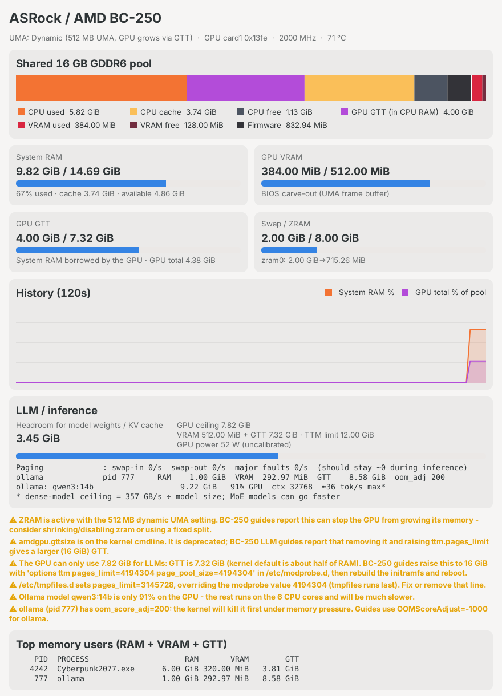

# BC-250 RAM Monitor

A small CachyOS (and other Arch-based) desktop app that shows memory usage on the
**ASRock / AMD BC-250**, the PS5-derived mining board ("Cyan Skillfish" APU,
6 Zen 2 cores, 24 RDNA2 CUs).



## Why a BC-250-specific monitor?

The BC-250 has **no separate RAM and VRAM**. It has one **16 GB GDDR6 pool** shared by
the CPU and GPU. Normal tools like `free` or htop only show the CPU's share, so the
numbers look wrong. This app shows the whole pool:

| Part | Where it comes from |
|---|---|
| **System RAM** (CPU side) | `/proc/meminfo` |
| **VRAM carve-out** set by the BIOS *UMA Frame Buffer Size* (512 MB dynamic, 4 GB, 8 GB...) | `mem_info_vram_*` in amdgpu sysfs |
| **GTT**: system RAM the GPU borrows (this is where games live in 512 MB dynamic mode) | `mem_info_gtt_*` |
| **Firmware reserved**: what is left of the 16 GB that neither side reports | 16 GB − the two above |
| **ZRAM / swap**, including compression ratio | `/sys/block/zram*` |
| **Per-process RAM + VRAM + GTT** (e.g. a game under Proton) | `/proc/*/status`, amdgpu `fdinfo` |

It also shows the GPU clock and temperature, and gives BC-250-specific warnings:

- ZRAM enabled together with the 512 MB dynamic UMA setting. Community guides report this can stop the GPU from growing its memory.
- `amdgpu.gttsize` missing from the kernel cmdline while in dynamic mode.
- The shared pool nearly full, GTT above 90%, the fixed carve-out full, or a hot GPU.

### LLM / inference panel

The BC-250 is popular for running local LLMs (Ollama or llama.cpp with Vulkan). The
problems that come up there are mostly about memory, so the app adds:

- **GPU memory ceiling.** VRAM carve-out + GTT, capped by **TTM `pages_limit`**, which is
  the real limit on current kernels (`/sys/module/ttm/parameters/pages_limit`). The
  default is about 7.4 GiB. BC-250 LLM guides raise it to 16 GiB with
  `options ttm pages_limit=4194304 page_pool_size=4194304` in `/etc/modprobe.d/`.
- **Headroom.** How much more model weights or KV cache can still load (free VRAM + free
  GTT, bounded by `MemAvailable`, since GTT comes out of system RAM).
- **LLM processes** (ollama, llama-server, koboldcpp, whisper, sd, ...) with their RAM, VRAM,
  GTT and `oom_score_adj`.
- **Ollama models** loaded (from `/api/ps` on `$OLLAMA_HOST` or `127.0.0.1:11434`): size, % on the GPU,
  context length, and a rough tokens/s ceiling (357 GB/s measured bandwidth ÷ model size).
  That ceiling only applies to dense models; MoE models can beat it.
- **Paging rates** (swap-in/out, major faults per second). If these rise during
  inference, tokens/s drops sharply.
- **GPU power** from the SMU sensor (uncalibrated).
- **Warnings** for:
  - the deprecated `amdgpu.gttsize`
  - a GTT/TTM cap under 15 GiB
  - a `/etc/tmpfiles.d` line silently overriding the modprobe `pages_limit` (a known 12 GiB trap)
  - thrashing
  - under 512 MB headroom while an LLM runs
  - an Ollama model partly on the CPU
  - an LLM process the OOM killer would pick first

For benchmarks, `bc250-ram-monitor --log run.csv` writes one CSV row per second.

The board is detected by its GPU PCI ID `1002:13fe`. On any other AMD GPU the app still
runs and shows generic data.

## Install on CachyOS

```sh
git clone <this repo> && cd bc250-ram-monitor
./install.sh --deps        # pacman -S python-gobject python-cairo gtk4, then install to ~/.local
```

Or as a real package: `makepkg -si`

Then open **BC-250 RAM Monitor** from the app menu, or run `bc250-ram-monitor`.

## Usage

```
bc250-ram-monitor          # GTK4 window, updates every second
bc250-ram-monitor --cli    # live terminal view (no GTK needed, works over SSH)
bc250-ram-monitor --once   # print one report and exit
bc250-ram-monitor --log run.csv   # CSV log every second (LLM benchmarks)
```

No root needed. Everything is read from procfs/sysfs.

## Testing without a BC-250

```sh
tests/make_fake_root.sh /tmp/fakebc250
BC250_SYSROOT=/tmp/fakebc250 ./bc250-ram-monitor
```

Uninstall: `./install.sh --uninstall`
